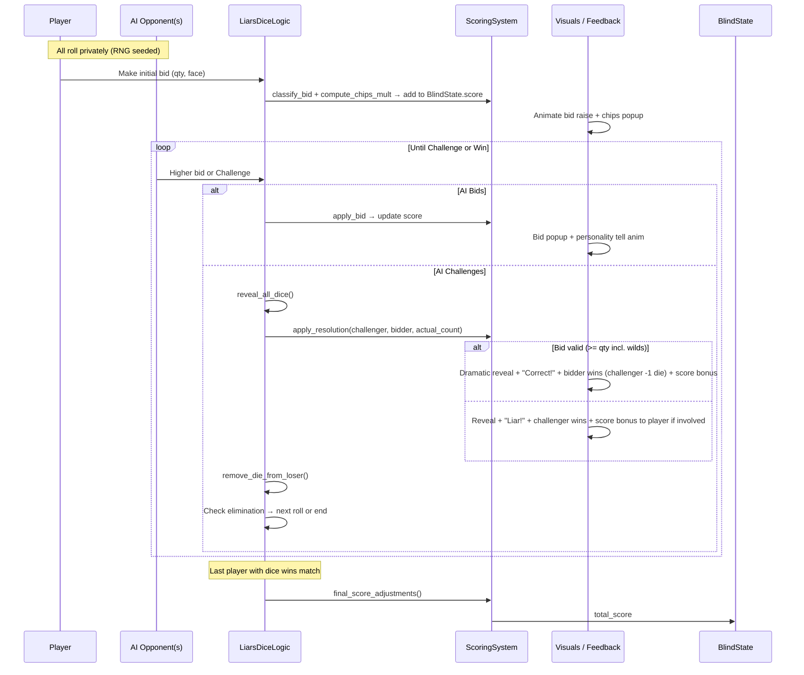

# Design Document: Balatro-like Liar's Dice

**Title**: Balatro-like Liar's Dice (Roguelike Dice Bluffing Game)  
**Author**: [Grok / Systems Architect placeholder]  
**Date**: 2026-06-17  
**Status**: Draft (updated 2026-06-17 with user answers to Open Questions)  
**Project**: Godot 4 implementation of Balatro mechanics fused with classic Liar's Dice core gameplay.  
**Target**: Godot 4.6 (primary). All project.godot settings and code target 4.6 features while remaining mindful of 4.3+ compatibility where easy.  
**Workspace**: `/Users/cyotee/Development/github-cyotee/game-liars-dice` (initially empty)  

---

## Overview

This document outlines the architecture and implementation plan for a single-player roguelike game that fuses the deep progression, shop economy, "Chips × Mult" scoring, and audiovisual polish of *Balatro* with the bluffing, bidding, and social deduction tension of *Liar's Dice*.

The game is structured as run-based progression through 8 Antes. Each Ante consists of Small Blind → Big Blind → Boss Blind. In each blind, the player participates in a 4-player Liar's Dice match (player + 3 AI) using hidden dice. Bids and challenge resolutions generate "score" using a Chips × Mult formula analogous to Balatro poker hands (see "Balatro Hands Analog (Player Bid Actions)" terminology). "Jokers", "Planets" (bid category upgrades), "Tarots" (one-time abilities usable on the player's turn; may receive pirate-themed art later), and "Vouchers" provide deep synergies and power scaling. The player must reach escalating score targets to defeat each blind while managing a shared economy.

Core Liar's Dice rules are preserved (private rolls, strictly ascending bids of "at least N dice showing face F", challenge/reveal, dice loss/gain on loss or modifiers). Code supports a variable number of dice per participant (starts at 5; can be changed by rules or future modifiers). Reroll capability is implemented in the core logic for use by modifiers even if not exposed in pure classic MVP play. The Balatro loop (blinds → shop → progression) and feedback systems wrap and elevate the experience. Visuals target polished pixel art with dramatic reveals, flying score popups, screen effects, and satisfying dice roll/animation feedback (no complex physics; see Non-Goals).

The project starts from a completely empty directory and requires full Godot project bootstrap, pixel-art-correct configuration, deterministic RNG for seeded runs, clean state separation, and strong separation of logic/presentation.

---

## Background & Motivation

**Current State (empty workspace)**: No code, assets, or Godot project exists. Confirmed via `ls -la` showing only `.` and `..`.

**Balatro elements** (from Balatro wiki sources):
- 8 Antes per run.
- Per Ante: Small (1x base score target, ~$3 reward), Big (1.5x, ~$4), Boss (2x + effect, ~$5; Showdown at Ante 8 for ~$8).
- Shop appears after every blind: Jokers (modifiers), consumables (Planets/Tarots), Vouchers (permanent), rerolls.
- Economy: blind rewards + interest ($1 per $5 held, cap $5) + unused "hands" bonus + sell value. Rerolls start at $5 and increase by $1 within a shop.
- Scoring: Chips × Mult. Base from hand type/level. Additive +Mult then xMult applied left-to-right on Jokers. Planets level hands. Massive synergies and scaling.
- Highly polished feedback is core to the appeal.

**Liar's Dice elements** (standard single-hand rules, Wikipedia + common variants):
- Variable dice per player (starts at 5 six-sided dice). Private rolls under "cups". Dice count changes during play.
- Bids: "At least N dice show face F" across all dice. 1s commonly wild.
- Strictly higher bids only: ↑ quantity or (same quantity + ↑ face).
- Challenge ("Liar!"): Full reveal. If count (including wilds) >= N, bidder wins (challenger loses 1 die); else challenger wins (bidder loses 1 die).
- Continue until one player remains with dice. Loser of prior round often starts next.

**Pain points addressed by fusion**:
- Pure Liar's Dice lacks long-term progression, unlocks, and "build crafting".
- Balatro's roguelike loop + jokers provides exactly the missing depth and replayability.
- Existing no direct "Balatro Liar's Dice" clones (confirmed via prior search); this is original IP fusion.
- Godot 4 is ideal: excellent 2D tooling, AnimationPlayer/Tween/GPUParticles, SubViewport + pixel snapping for crisp art.

**Why now**: Empty repo allows clean architecture from day 1. Strong audiovisual feedback + determinism + AI personalities will differentiate it.

---

## Goals & Non-Goals

**Goals (MVP scope)**:
- Implement the full Antes/Blinds/Shop loop for 8 Antes (win on defeating Ante 8 Showdown).
- Faithful Liar's Dice core (4 players, variable dice per player starting at 5, standard bidding + wild 1s + challenge resolution; supports gaining/losing dice via rules and modifiers).
- Scoring pipeline: Bids classified into categories; generate Chips × Mult using Jokers + leveled Planets.
- Win condition per blind: elimination of all opponents in the group **or** reaching the score target, whichever the player meets first. Tutorial blind uses simplified "eliminate the opponent" only.
- Basic Jokers (5-8), Planets (3-4 bid categories), Tarots (one-time turn abilities: change value of X dice +/- Y, reroll X dice, learn value of X dice across Y opponents; higher magnitude rarer), Vouchers (2-4).
- Structured opponent rank progression (Cabin Boy tutorial → Sailor → Cook groups → QuarterMaster → Captain + crew) with class-specific behavior parameters. Core AI system supports variable difficulty via tunable heuristics (aggression, challenge threshold, risk tolerance, tells). See AI System section for details and exploration items.
- Deterministic seeded runs (reproducible via seed).
- Shop: buy/sell/reroll with proper economy (interest, blind rewards, unused "action" bonus).
- Godot project bootstrap + pixel art settings + placeholder graphics + tween/particle feedback for key events (roll, bid, challenge, reveal, score pop). Placeholder graphics to be replaced later with sourced free assets then custom art.
- State management: serializable RunState / BlindState.
- Input: mouse + keyboard bidding UI (touchscreen support deferred to mobile version).
- Save/load for current run + seed using Godot Resources + sidecar files for platform portability.
- MVP scope explicitly defined below.

**Non-Goals (for v1 / MVP)**:
- Full Balatro-scale content (no 150 Jokers; no 30+ Bosses).
- Multiplayer (human or online).
- Stakes / deck unlocks / collection / endless mode (basic endless optional post-MVP).
- Advanced audio (placeholder SFX only; music stretch).
- Complex dice modifiers/physics (simple sprites + animations).
- Performance for >20 dice or heavy particle spam (target is low).
- Cross-platform exports beyond desktop (initial focus on PC; design for later mobile reuse with variable play space and input).
- Procedural art generation or advanced shaders (pixel sprites assumed).
- "Exact count" special penalty variants unless simple.

**Quantified Targets (MVP)**:
- Score targets scale similarly to Balatro (Ante 1 Small ~300 base equivalent; higher Antes exponential).
- All participants start with 5 dice (variable thereafter). Max ~20 dice visible at once in later blinds.
- Bidding latency target: <100ms resolution + animation.
- Determinism: same seed + same player actions → identical run.
- Run duration: 15-40 min typical.

---

## Proposed Design

### High-Level Architecture

```mermaid
flowchart TD
    A[Main Menu / New Run<br/>(seed input)] --> B[RunState Init<br/>(money=4, 5 jokerslots, dice=5 per player (variable), planets lvl1)]
    B --> C[Ante Loop<br/>1..8]
    C --> D[Small Blind]
    D --> E[Big Blind]
    E --> F[Boss / Showdown Blind]
    F --> G{Blind Beaten?}
    G -->|No| H[Game Over / Run Summary]
    G -->|Yes| I[Cash Out<br/>(rewards + interest + unused bonus)]
    I --> J[Shop Scene<br/>(Jokers, Planets, Tarots, Vouchers + Reroll)]
    J --> K[Next Blind or Next Ante]
    K --> C
    H --> L[Seed Replay / Quit]

    subgraph "Per-Blind"
      M[BlindState: dice pools, current_bid, score=0, hands_used]
      N[Roll Phase] --> O[Bidding Loop]
      O --> P{Player or AI turn}
      P -->|Bid| Q[Validate strictly higher → ScoringSystem.apply_bid(bid) → add to score]
      P -->|Challenge| R[RevealAll → Count matches (wild 1s) → Loser loses die → ScoringSystem.apply_resolution()]
      R --> S[Check win condition or continue]
      S --> O
      M --> T[End Blind: All opponents eliminated OR score >= target (whichever first)]
    end
```

### Bidding + Challenge Sequence (Core Loop)



### Joker / Scoring Pipeline

```mermaid
flowchart LR
    Bid[Bid Placed<br/>qty=4, face=6] --> Classify[Classify into Category<br/>e.g. HIGH_QUANTITY or HIGH_FACE]
    Classify --> Base[BaseChips = qty * face_map(face)<br/>BaseMult = 1 + risk_bonus(face)]
    Base --> Planets[Apply Planet Levels<br/>e.g. +Chips +Mult per level for category]
    Planets --> Jokers[Jokers (left → right order)<br/>+Chips, +Mult, xMult, conditional]
    Jokers --> Resolution[On Challenge/Resolution:<br/>+bonus chips/mult based on outcome + involved jokers]
    Resolution --> Final[Score += Chips × Mult<br/>(additive before multiplicative)]
    Final --> Popups[Flying numbers + mult text + screen effects]
```

**Scoring Details** (provisional but complete and concrete for MVP implementation; moved from Open Questions per review):

- Only the *human player's* bids and resolution outcomes contribute to the blind's `score` (AI bids do not add to player's total). This keeps the "player must beat target" clear.
- **Base contribution** (per player bid, and per resolution where player is bidder or challenger):
  ```gdscript
  # In ScoringSystem
  static func compute_base(bid_qty: int, bid_face: int) -> Dictionary:
      var face_val: int = 6 if bid_face == 1 else bid_face   # 1s are wild but high-value for base
      var base_chips: int = bid_qty * face_val * 8           # Provisional constant tuned for targets
      var base_mult: float = 1.0 + max(0, (bid_qty - 2) * 0.05)  # Slight bonus for higher qty bids
      if bid_face == 6:
          base_mult += 0.15   # Risky high face reward
      elif bid_face <= 2:
          base_mult += 0.10   # Risky low face
      return {"chips": base_chips, "mult": base_mult}
  ```
- **Hands analog for economy** (explicit definition, resolving OQ #2): 
  - Track `player_bids_made: int` (number of times human player placed a bid) + `sub_rounds_completed: int` (full dice rolls resolved).
  - `player_actions_used = player_bids_made + (sub_rounds_completed / 2.0)` (floored; sub-rounds partially count to reflect participation).
  - Per blind "base_actions" budget (for reward calc): 4 for Small/Big, 3 for Boss.
  - Unused bonus at cash-out: `$1 * max(0, base_actions - floor(player_actions_used))`.
  - This fits continuous Liar's Dice while providing "fewer actions = more money" like Balatro hands. `hands_used` in BlindState is an alias for `player_actions_used` for legacy naming.
- Order always: base → planet_levels[category] additives → jokers left-to-right (+chips / +mult first, then xMult sequentially). Final contrib = floor(chips * mult).
- Final blind score = sum of player's contributions. Win if >= target_score at end of match (even on last challenge).
- Target examples (scaled from Balatro data): Ante 1 Small: 300, Big: 450, Boss: 600; higher Antes increase 2-3x per level (see referenced Balatro table). Constants above calibrated so a typical 5-8 bid match with modest jokers reaches ~320-450.
- Update BlindState:
  ```gdscript
  @export var player_bids_made: int = 0
  @export var sub_rounds_completed: int = 0
  @export var score: int = 0   # Only player contributions
  ```

**Worked Example: Full 4-Player Blind Trace (Ante 1 Small, target=300)**

Concrete simulation trace (4 players: Human + AI1/Aggressive, AI2/Conservative, AI3/Balanced). All start 5 dice. RNG seeded. Player has Planet HIGH_FACE lvl1 (+15 chips / +0.2 mult) and Planet HIGH_QUANTITY lvl1 (+20 chips / +0.5 mult). (Jolly joker +8 additive mult on high qty shown in ScoringSystem.apply_jokers code; this trace uses base + planets only for clean numbers matching the functions exactly. Full joker application follows left-to-right additive then xMult order.)

Initial roll (sub_round 0, hidden):
- Human: [3,4,6,1,2] (sees own)
- AI1: [6,6,3,2,5]
- AI2: [1,4,4,4,6]
- AI3: [2,2,5,3,1]

1. Human bids qty=2 face=6 (classifies HIGH_FACE)
   compute_base(2,6) = chips=2*6*8=96, mult=1.0 + 0.15 = 1.15
   + Planet lvl1: +15 chips +0.2 mult → chips=111, mult=1.35
   contrib1 = floor(111 * 1.35) = 149
   Player score = 149. player_bids_made=1. current_bid updated.

2. AI1 raises to 3/6.
3. Player challenges (resolution).
   Actual count (incl 1s wild): 4 sixes across table. Bid valid (3 <= 4). Player (challenger) loses 1 die. player_dice=4.
   Resolution bonus (player challenger): +30 chips base (no joker bonus in this context).
   contrib2 = 30
   Player score = 149 + 30 = 179. sub_rounds_completed = 1.

4. New roll (sub_round 1).
5. Player bids qty=3 face=4 (classifies HIGH_QUANTITY)
   compute_base(3,4) = chips=3*4*8=96, mult=1.0 + 0.05 = 1.05
   + Planet lvl1: +20 chips +0.5 mult → chips=116, mult=1.55
   contrib3 = floor(116 * 1.55) = 179
   Player score = 179 + 179 = 358 > 300.
   player_bids_made=2.

Final: player_bids_made=2, sub_rounds_completed=1 → player_actions_used = 2 + floor(1/2) = 2. base_actions=4 → unused bonus = $2 (plus blind $3 + interest).

This trace demonstrates per-bid + resolution contributions using the exact compute_base, only player score counts toward target, hands bonus calc, and reaching target via 2 bids + 1 resolution. (AI bids ignored for score; full match would include more actions and potential elimination. Joker +8 mult would be applied via apply_jokers for HIGH_QUANTITY bids in builds that include it.)

**Economy & Shop** (updated):
- Blind reward on win: Small $3, Big $4, Boss $5, Showdown $8.
- Unused hands (player_actions) bonus: calculated as above.
- Interest: at cash-out, + min(5, floor(money / 5))
- Reroll: $5 first, +1 each subsequent in shop. Resets per shop.
- Sell value: usually floor(cost / 2) or per Balatro formula.
- Debt via Credit-Card analog Joker (stretch).

### Godot Scene / Node Architecture (High-Level)

```mermaid
flowchart TD
    Root[Main.tscn / root Node]
    Root --> GameManager[GameManager (Node) autoload? or in Main]
    GameManager --> RunManager[RunManager (Node)]
    RunManager --> BlindScene[BlindScene.tscn<br/>CanvasLayer + Control]
    RunManager --> ShopScene[ShopScene.tscn]

    BlindScene --> Table[TableNode2D]
    Table --> PlayerCup[PlayerCup.tscn<br/>Node2D + AnimationPlayer + DiceContainer]
    Table --> AICups[AI1Cup, AI2Cup, AI3Cup]
    Table --> BidUI[BidUI.tscn<br/>Control: Qty buttons, Face buttons, CurrentBid label, Challenge button]
    Table --> ScoreUI[ScoreUI: running chips/mult displays, target]

    PlayerCup --> DiceSprites[5x DiceSprite2D (hidden by default)]
    AICups --> DiceSprites

    BlindScene --> Feedback[FeedbackLayer: GPUParticles2D, Label popups, Tween targets]

    subgraph "Autoloads / Systems"
      GS[GameState autoload<br/>RunState holder]
      RNG[RNGManager autoload<br/>seeded RandomNumberGenerator]
      Audio[AudioManager]
      Save[SaveManager]
    end

    GS --> RunState[RunState.gd : Resource]
    RunState --> BlindState[BlindState.gd : Resource]
```

**Recommended Directory Structure** (create on bootstrap):

```
.
├── project.godot
├── .gitignore
├── README.md
├── scenes/
│   ├── Main.tscn
│   ├── ui/
│   │   ├── MainMenu.tscn
│   │   ├── BidUI.tscn
│   │   ├── ShopItem.tscn
│   │   └── ...
│   ├── game/
│   │   ├── BlindScene.tscn
│   │   ├── ShopScene.tscn
│   │   └── RunSummary.tscn
│   └── entities/
│       ├── PlayerCup.tscn
│       ├── AICup.tscn
│       └── Dice.tscn
├── scripts/
│   ├── autoload/
│   │   ├── GameState.gd
│   │   ├── RNGManager.gd
│   │   ├── AudioManager.gd
│   │   └── SaveManager.gd
│   ├── resources/
│   │   ├── Joker.gd
│   │   ├── Planet.gd
│   │   ├── Tarot.gd
│   │   ├── Voucher.gd
│   │   └── BidCategory.gd
│   ├── states/
│   │   ├── RunState.gd
│   │   └── BlindState.gd
│   ├── systems/
│   │   ├── LiarsDiceLogic.gd
│   │   ├── ScoringSystem.gd
│   │   ├── AISystem.gd
│   │   └── EconomySystem.gd
│   ├── ui/
│   │   ├── BidUI.gd
│   │   └── ...
│   └── ...
├── resources/
│   ├── jokers/
│   │   ├── basic_joker.tres
│   │   └── ...
│   └── ...
├── assets/
│   ├── sprites/
│   │   ├── dice_*.png (6 faces + back + cup)
│   │   └── ui/
│   └── audio/
│       └── (placeholders)
└── tests/   (optional GUT or manual)
```

**Key Godot Project Settings** (in `project.godot` or via Editor → Project Settings; enable Advanced):

- `display/window/size/viewport_width` = 1028
- `display/window/size/viewport_height` = 768
- `display/window/stretch/mode` = "viewport" (or "canvas_items" for heavy animation scenes; see Tradeoff section)
- `display/window/stretch/aspect` = "keep"
- `display/window/stretch/scale_mode` = "integer"   # Godot 4.3+
- `rendering/textures/canvas_textures/default_texture_filter` = 0 (Nearest)
- `rendering/2d/snap/snap_2d_transforms_to_pixel` = true
- `rendering/2d/snap/snap_2d_vertices_to_pixel` = true (optional)
- `application/run/main_scene` = "res://scenes/Main.tscn"
- Input map: "bid_confirm", "challenge", number keys, etc.

**Viewport + Animations/Particles Tradeoff & Cross-Platform Considerations**:
No strong preference. Choose the easiest approach that supports a variable play space size and reuse across platforms (PC now, mobile later with touch input).

Viewport + integer scaling gives crisp pixel art but can make Tweens/particles look jagged when upscaled. Heavy animation scenes may prefer `canvas_items`.

**Recommended for PR1**:
- Use 1028x768 as the base resolution (both viewport and initial window size target).
- Start with `display/window/stretch/mode = "canvas_items"` + integer scale for simplicity (good for variable play space and future mobile).
- Hybrid SubViewport option (explained below) is available if we want crispest dice while keeping good animations.
- PR1 verification scene will demonstrate the chosen approach.
- Always enable Nearest filter, snap flags, and integer scale.
- Design UI and table elements to be flexible for different aspect ratios / safe areas on mobile.

**Hybrid SubViewport Option Explanation**:
In Godot, there are two common ways to handle pixel art + animations:

- **canvas_items** (recommended starting point for now): The entire scene renders at the window resolution with integer scaling. Easier for particles, Tweens, and UI. Dice sprites use Nearest filtering. Good when you want flexible layouts and easier cross-platform support.

- **Hybrid SubViewport**: 
  - Put the game table + dice in a SubViewport (set to a logical resolution with Nearest filtering and snapping) inside a SubViewportContainer. This keeps dice and table perfectly crisp and pixel-snapped even at higher scales.
  - Put floating UI, score popups, particles, and feedback on a sibling CanvasLayer at full window resolution.
  - This gives the best of both worlds: crisp dice/table + smooth high-res effects.
  - Trade-off: Slightly more complex node setup, camera handling, and some extra code for coordinating the two layers. It can be better when you want a "fixed play space" for the dice while allowing UI to adapt for mobile (different safe areas, touch targets).

We will prototype the chosen approach in PR1 and can switch if needed. The current default is canvas_items for faster iteration.

This decision will be validated early in PR1 with a test scene. The goal is maintainability for future platform ports.

**Input Handling**: BidUI uses `Button`s + keyboard shortcuts (`1-9` for qty, `1-6` for faces, `C` or `Space` for challenge). Mouse drag not required; simple clicks. Disable invalid bid options (enforce strictly higher rule in UI + server logic).

### Bootstrap Artifact Examples (for PR1; addresses Issue 8)

**Minimal project.godot additions** (paste into [application], [display], [rendering], [input], [autoload] sections):
```
[application]
run/main_scene="res://scenes/Main.tscn"
config/name="Liars Dice Balatro"

[display]
window/size/viewport_width=1028
window/size/viewport_height=768
window/stretch/mode="canvas_items"
window/stretch/aspect="keep"
window/stretch/scale_mode="integer"

[rendering]
textures/canvas_textures/default_texture_filter=0
2d/snap/snap_2d_transforms_to_pixel=true

[input]
challenge={
"deadzone": 0.5,
"events": [Object(InputEventKey,"resource_local_to_scene":false,"resource_name":"","device":-1,"window_id":0,"alt_pressed":false,"shift_pressed":false,"ctrl_pressed":false,"meta_pressed":false,"pressed":false,"keycode":67,"physical_keycode":0,"key_label":0,"unicode":99,"location":0,"echo":false,"script":null)
, Object(InputEventKey,"resource_local_to_scene":false,"resource_name":"","device":-1,"window_id":0,"alt_pressed":false,"shift_pressed":false,"ctrl_pressed":false,"meta_pressed":false,"pressed":false,"keycode":32,"physical_keycode":0,"key_label":0,"unicode":0,"location":0,"echo":false,"script":null)
]
}
# Add bid_1 ... bid_6, qty keys similarly

[autoload]
RNGManager="*res://scripts/autoload/RNGManager.gd"
GameState="*res://scripts/autoload/GameState.gd"
SaveManager="*res://scripts/autoload/SaveManager.gd"
AudioManager="*res://scripts/autoload/AudioManager.gd"
```

**.gitignore** (standard + Godot):
```
# Godot
.godot/
*.import
export_presets.cfg
# ...
```

**Autoload registration**: In editor Project Settings → Autoload tab (or edit .godot); singleton names match. Add .gdignore in assets/ if needed for imports (mipmaps off, filter=Nearest inherit on sprites).

These artifacts in PR1 deliverable enable "start coding immediately".

### Data Models (GDScript Resources / Classes)

```gdscript
# scripts/resources/Joker.gd
class_name Joker
extends Resource

@export var id: StringName
@export var display_name: String
@export var rarity: int # 0=Common ... 3=Legendary
@export var cost: int = 3
@export var description: String
# Data-driven effects (preferred over script for MVP; see apply below)
@export var effect_type: StringName   # e.g. &"ADD_CHIPS_PER_DIE", &"X_MULT_ON_CHALLENGE", &"ECONOMY_ON_DIE_LOSS"
@export var effect_value: float = 0.0
@export var effect_category: StringName = &""  # for conditional

# scripts/states/RunState.gd (extends Resource for easy save)
class_name RunState
extends Resource

@export var seed: int
@export var ante: int = 1
@export var money: int = 4
@export var jokers: Array[Joker] = []
@export var joker_slots: int = 5
@export var planet_levels: Dictionary = {} # { "HIGH_QUANTITY": 1, ... }
@export var vouchers: Array = []
@export var tarot_effects: Array = [] # persistent dice mods
@export var hands_played_this_run: int = 0 # for tracking / tags
# ... unlocks, stats

# scripts/states/BlindState.gd
class_name BlindState
extends Resource

@export var blind_type: String # "small", "big", "boss"
@export var target_score: int
@export var score: int = 0   # Sum of *player's* bid + resolution contributions only
@export var player_dice: int = 5
@export var ai_states: Array[Dictionary] = [] # [{id, dice:5, personality:...}] (use typed inner or separate PlayerState Resource later)
@export var current_bid: Dictionary = {"qty":0, "face":0}
@export var bid_history: Array = []
@export var player_bids_made: int = 0
@export var sub_rounds_completed: int = 0
@export var hands_used: int = 0 # alias = floor(player_bids_made + sub_rounds_completed/2) for economy
@export var rolled_dice: Dictionary = {} # per player id -> [values] ; populated on each roll
```

**Serialization example** (add to RunState/BlindState or helper in SaveManager):
```gdscript
func to_dict() -> Dictionary:
    return {
        "score": score,
        "player_bids_made": player_bids_made,
        # ... other fields; for nested Resources use .duplicate() or manual
        "ai_states": ai_states.duplicate(true),
        # For full Resources: use ResourceSaver or JSON with id refs
    }
static func from_dict(d: Dictionary) -> BlindState:
    var s = BlindState.new()
    s.score = d.get("score", 0)
    # ... populate; re-init RNG from seed on load
    return s
```

### Concrete Resource & Effect Application Examples (Issue 4 resolution)

**BidCategory.gd** (minimal Resource):
```gdscript
# scripts/resources/BidCategory.gd
class_name BidCategory
extends Resource

@export var id: StringName   # &"HIGH_QUANTITY", &"HIGH_FACE", &"RISKY_LOW", &"ANY"
@export var display_name: String
@export var description: String

static func classify_bid(qty: int, face: int) -> StringName:
    if qty >= 4: return &"HIGH_QUANTITY"
    if face >= 5: return &"HIGH_FACE"
    if face <= 2: return &"RISKY_LOW"
    return &"ANY"
```

**Joker effect applicator** (data-driven in ScoringSystem; no effect_script for MVP):
```gdscript
# Inside ScoringSystem or Joker helper
static func apply_joker_effect(joker: Joker, chips: int, mult: float, run: RunState, blind: BlindState, context: Dictionary) -> Dictionary:
    match joker.effect_type:
        &"ADD_CHIPS_PER_DIE":
            chips += int(joker.effect_value * blind.player_dice)
        &"ADD_MULT":
            mult += joker.effect_value
        &"X_MULT_ON_CHALLENGE_SUCCESS":
            if context.get("player_was_challenger", false) and context.get("bid_was_correct", false):
                mult *= joker.effect_value
        &"ECONOMY_ON_OPPONENT_DIE_LOSS":
            # Side effect: handled in EconomySystem on resolution
            if context.get("opponent_lost_die", false):
                run.money += int(joker.effect_value)
        # ... more
    return {"chips": chips, "mult": mult}
```

**Full minimal ScoringSystem.apply_jokers** (left-to-right, additive then xMult):
```gdscript
# scripts/systems/ScoringSystem.gd
static func apply_jokers(initial_chips: int, initial_mult: float, jokers: Array[Joker], run: RunState, blind: BlindState, context: Dictionary) -> Dictionary:
    var chips: int = initial_chips
    var mult: float = initial_mult
    for j in jokers:
        if not is_joker_active(j, context): continue   # e.g. skip disabled by boss
        var res = apply_joker_effect(j, chips, mult, run, blind, context)
        chips = res.chips
        mult = res.mult
    return {"chips": chips, "mult": mult}

static func compute_contribution(bid_qty: int, bid_face: int, run: RunState, blind: BlindState, context: Dictionary) -> Dictionary:
    var base = compute_base(bid_qty, bid_face)
    var cat = BidCategory.classify_bid(bid_qty, bid_face)
    var p_level: int = run.planet_levels.get(cat, 1)
    var chips: int = base.chips + (p_level - 1) * 20
    var mult: float = base.mult + (p_level - 1) * 0.5
    var final = apply_jokers(chips, mult, run.jokers, run, blind, context)
    var contrib = int(final.chips * final.mult)
    return {"chips": final.chips, "mult": final.mult, "contrib": contrib, "category": cat}

static func add_player_contribution(blind: BlindState, contrib: int):
    blind.score += contrib
    # Also update actions in caller
```

**LiarsDiceLogic.gd** (stateless pure functions + state mutations):
- Full support for **variable dice per participant** (player and opponents can have different counts; start at 5; gain/lose via rules and modifiers).
- `roll_all(state, rng)`
- `roll_dice(player_id, indices, rng)` — supports targeted rerolls (used by future modifiers/Tarots even if not available in pure classic rules for MVP).
- `is_valid_higher_bid(current, new_qty, new_face) -> bool`
- `resolve_challenge(state, challenger_id) -> {winner, loser, actual_count, actual_count_incl_wild}`
- Enforce 1s wild: count = count_exact(face) + count_exact(1)  (boss can override)

### AI System & Opponent Ranks / Progression Ladder

The game uses a structured progression of opponent "ranks" (pirate ship roles) instead of generic AI. The player faces escalating groups of opponents until the group is eliminated. Each blind is a full Liar's Dice match against the current group (variable number of opponents per rank tier). 

**Win Condition per Blind**: The player beats the blind by either:
- Eliminating all opponents in the current group, **or**
- Reaching the score target

Whichever happens first. (This may be adjusted after playtesting.)

All opponent classes start with 5 dice. Dice count per participant (player and opponents) is fully variable and can change during play.

**Progression Ladder (MVP tiers):**
- Tutorial / First round: 1 × Cabin Boy (easiest; intended for learning the rules). For the tutorial blind only, the win condition is simplified to "play until the opponent is eliminated" (score target is not enforced).
- Next: 2 × Sailor
- Next: 1 × Cook + 2 × Cabin Boy
- Next: 1 × QuarterMaster + 3 × Sailor
- Final: 1 × Captain + 1 × Ship's Mate + 1 × Cabin Boy + 1 × Sailor

All ranks start with 5 dice. Difficulty comes primarily from AI behavior parameters.

**Defining Class Difficulty & Distinction (to be explored and tuned in PRs 7-8):**
Each class is defined by a set of tunable parameters that affect bidding, challenging, and risk tolerance. Key dimensions to implement and balance:
- Aggression bias (tendency to raise quantity vs. face value)
- Challenge threshold (how low the estimated probability must be before calling "Liar")
- Bluff frequency / tells strength (how often they overbid and how visible the tells are)
- Information use (how well they model hidden dice distributions; some classes may have slight "memory" or better EV calculation)
- Risk tolerance with low dice count (e.g., Cabin Boy becomes very conservative when low on dice; Captain stays aggressive)
- Reaction to player strength (some classes "respect" high bids more)

For the tutorial Cabin Boy: Use very simple and predictable behavior (safe/low bids, rarely challenges, obvious patterns) so the player can learn the core Liar's Dice rules.

All classes use the same core `AISystem` heuristics but with different parameter sets and slight rule variations (e.g., a class might never bid faces below 3). RNGManager ensures deterministic behavior for a given seed.

Knowledge remains limited (own dice + global expectations). Visual tells (hesitation, animation variance) are stronger on lower ranks.

**Future extension:** Modifiers/Jokers can alter opponent dice counts or temporarily change a class's parameters for a blind.

### Economy & Shop

- Blind reward on win: Small $3, Big $4, Boss $5, Showdown $8.
- Unused "hands" bonus: $1 per unused "bid action" or alternatively $1 per sub-round not needed (tunable; document decision).
- Interest: at cash-out, + min(5, floor(money / 5))
- Reroll: $5 first, +1 each subsequent in shop. Resets per shop.
- Sell value: usually floor(cost / 2) or per Balatro formula.
- Debt via Credit-Card analog Joker (stretch).

Shop populates from pools filtered by rarity/ante + current jokers (no duplicates unless Showman-like).

**Tarots (one-time turn abilities)**:
Defined as Resources. Used on the human player's turn inside a blind.

**Usage Flow**: On the player's turn, they may choose to play a Tarot card *before bidding*. The Tarot takes effect immediately, then the player makes their bid as normal.

Example effects (implemented via context passed to effect applicator):
- Change value of X dice by +/- Y (clamped to 1-6)
- Reroll X of the player's own dice
- Reveal the values of X dice belonging to Y different opponents (not per-opponent full hand)
Higher magnitude (X/Y) cards are rarer. Can be played for powerful information or manipulation mid-match. Art is placeholder (Tarot style) with note to possibly retheme to pirate items later.

### Determinism & Save/Load

- RNGManager: holds `RandomNumberGenerator` initialized with run seed + ante/blind salt.
- All random calls (rolls, shop generation, AI decisions) go through it.
- Save: Use Godot Resource-based serialization (e.g. `ResourceSaver` for RunState/BlindState) + sidecar JSON (for human-readable seed, action log, and cross-platform portability). On load, re-init RNG from seed and restore state + replay log if needed. Prefer Resources + sidecar for platform portability.
- Reproducibility: record player action log per blind for exact replays.

### Feedback & Polish (Critical for Balatro-like feel)

- Variable frame rate (most of the game has low update frequency except during animations of dice rolls, reveals, or opponent actions).
- Every action: Tween for dice shake/roll, cup lift, number pop (Chips in green, Mult in purple, x in red).
- Particles: confetti on successful high bid/bluff, shatter on die loss, sparkle on shop purchase.
- Screen effects: flash white on challenge start, slow-mo optional on reveal.
- AudioManager: bank of SFX (dice_rattle, bid_raise, liar_call, die_break, score_ching, shop_buy). Use `AudioStreamPlayer`.
- UI polish: current bid always prominent, valid/invalid states with color + tooltip, player dice count HUD.

---

## API / Interface Changes

**New Public Interfaces** (example critical paths):

```gdscript
# scripts/systems/LiarsDiceLogic.gd
static func make_bid(state: BlindState, player_id: String, qty: int, face: int) -> bool
static func challenge(state: BlindState, challenger_id: String) -> Dictionary # result

# scripts/systems/ScoringSystem.gd
static func score_bid(bid: Dictionary, run: RunState, blind: BlindState) -> Dictionary # {chips, mult, final_contrib}
static func apply_resolution(result: Dictionary, run: RunState, blind: BlindState)

# RunManager
func start_blind(blind_config: Dictionary)
func enter_shop()
func end_run()
```

**UI Signals**:
- `BidUI.bid_submitted(qty, face)`
- `BidUI.challenged()`
- `Shop.item_purchased(item_resource)`

No breaking changes (new project).

---

## Data Model Changes

All new. Key serializable Resources listed above.

**Migration**: N/A (greenfield). Version the save schema from v0.1.

**Storage Estimates (rough)**:
- RunState JSON: < 5KB (dozens of jokers + small dicts).
- Full run history (optional): 50-200KB.
- Assets: sprites ~ few MB (pixel art).

---

## Alternatives Considered

**1. Pure Liar's Dice without scoring layer (just win/lose dice to beat blind)**  
Trade-offs: Simpler implementation; preserves pure bluff tension. Loses Balatro's "build to huge numbers" dopamine and "Chips × Mult" depth. Planets/Jokers would feel bolted on. **Rejected**: Violates core "Balatro-like" fusion goal and scoring philosophy.

**2. Replace bidding entirely with card-like "hands" drawn from a deck, using dice only for flavor**  
Trade-offs: Easier to port Balatro systems directly. Loses the unique bluffing and hidden-info core of Liar's Dice that makes the fusion interesting. **Rejected**: Must keep authentic Liar's Dice bidding/challenge as the primary interaction.

**3. Full physics-based dice (RigidBody2D per die)**  
Trade-offs: More "realistic" rolls and satisfying visuals. High variance in determinism, performance cost for 20+ bodies, complex collision tuning. **Rejected for MVP**: Use sprite animations + seeded RNG for rolls. Physics as stretch goal.

**4. Server-authoritative simulation vs. pure client GDScript**  
(Note: removed as non-applicable for offline single-player; not a meaningful explored trade-off for this project.)

**5. Stateless pure functions vs. stateful Node-based Logic**  
Trade-off: Pure functions (current choice in LiarsDiceLogic/ScoringSystem) easier to test/headless/replay + serialize but require explicit state passing. Stateful nodes simpler for Godot signals but harder to determinism/save. **Chose stateless + Resource state** for testability + save fidelity. (Added per review.)

**6. Immediate per-bid scoring vs. deferred until challenge/resolution**  
Trade-off: Immediate (current design) gives constant feedback like Balatro multiple hands + early particles. Deferred is simpler (one final calc). **Chose immediate per-player-bid + resolution** for "multiple hands" feel. (Added per review.)

---

## Security & Privacy Considerations

- Single-player offline game. No network, no auth.
- Seeded runs: seeds are user-visible and shareable by design (like Balatro). No secret state.
- Save files are local JSON/Resources. Warn on tampering (but no anti-cheat needed).
- No PII collection.
- RNG is deterministic for fairness/replay, not cryptographic.

**Threat model**: Local save editing for "cheat runs" is acceptable (common in roguelikes). Document seed + action log for verification of legit high scores.

---

## Observability

**Logging** (GDScript `print` + FileAccess for release):
- Key events: bid made, challenge result, score delta, shop transaction, die loss, blind win/loss.
- Include seed, ante, blind_type, current state snapshot (truncated).
- Log level: INFO for normal, DEBUG for RNG rolls and AI decisions.

**Metrics** (in-game + exportable):
- Per run: final ante reached, max score, money at each cashout, jokers acquired, bids made, challenges won/lost.
- Aggregate (local only): win rate by ante, favorite bid category.
- Hook `EconomySystem` and `ScoringSystem` for easy addition of counters.

**Alerting / Debug**:
- In-dev: overlay for current RNG state, dice counts, exact score calc breakdown.
- **Debug Overlay Implementation sketch** (CanvasLayer in BlindScene or global):
  ```gdscript
  # DebugOverlay.gd (CanvasLayer)
  func _process(_delta):
      if not visible: return
      $SeedLabel.text = "Seed: %d" % GameState.current_run.seed
      $RNGLabel.text = "RNG state: %d" % RNGManager.rng.state
      $ScoreBreakdown.text = "Score: %d / %d (last contrib %d)" % [blind.score, blind.target_score, last_contrib]
      # Update from autoloads + current BlindState
  ```
  Toggle with F3 or debug flag. Use Godot Remote Debug + built-in profiler for deeper.
- Godot debug console + `OS.is_debug_build()`.
- For production: optional crash report with seed + last 20 actions (user opt-in).

**Save schema versioning**:
- Include `"schema_version": 1` in saved dicts.
- On load: if version < current, apply simple migrations (e.g. add default fields) or warn. Bump version on breaking changes (e.g. adding player_bids_made).

**Performance**: Monitor dice count, active Tweens, particle count. Cap at low numbers.

---

## Rollout Plan

**Phase 0 (Bootstrap)**: Godot project + pixel settings + dir skeleton + basic Main scene + autoloads. (PR 1)

**Phase 1 (Core Loop + First Playable)**: Data + logic + scoring + blind visuals + BidUI for single blind stub. Playtest manually vs dummy. (PRs 2-4; milestone: playable single blind stub with real scoring after PR4)

**Phase 2 (Progression + Shop + Early Juice)**: Full run loop, cashout, shop/economy, real jokers + basic AI + feedback. (PRs 5-7)

**Phase 3 (Determinism + Polish + Boss)**: Seeding/save, boss variants, input/docs, debug. (PRs 8-9)

**Feature Flags / Staging** (via GameState flags or consts):
- `DEBUG_SHOW_ALL_DICE`
- `DISABLE_AI_TELLS`
- `FAST_ANIMATIONS`
- `UNLIMITED_MONEY`

**Staged Rollout** (internal):
1. Solo dev playtests (seeded runs).
2. Share seeds with friends for feedback.
3. Export desktop builds.
4. Post-MVP: itch.io / Steam page with seeded run sharing.

**Rollback**: Git tags per PR. Revert PRs independently since designed mergeable. Save format versioned from start.

---

## Key Decisions

1. **Chips × Mult scoring on top of Liar's Dice bids (not replacing bids)**: Rationale — preserves bluffing core while delivering Balatro's mathematical depth and scaling. Each bid + resolution contributes incrementally like playing multiple hands.

2. **Fixed 4-player (1 human + 3 AI) for v1**: Simplifies UI/table layout, AI tuning, and reveal animations. Scalable to more later via config.

3. **1s are wild (count for the bid face)**: Standard popular variant that increases bluff tension and math interest. Documented clearly.

4. **Resources (.gd + .tres) for Joker/Planet/etc. definitions**: Data-driven balancing without recompiles. Easy to add many later. Effect application via a context object passed to `apply_effect`.

5. **Seeded RNG via dedicated autoload + salt per phase**: Guarantees full run reproducibility from seed alone (critical for sharing "crazy runs").

6. **Logic systems (LiarsDiceLogic, ScoringSystem) pure from presentation**: Enables unit testing (even if manual), easy AI simulation, and future headless replays.

7. **Pixel art via Nearest + Snap 2D + Viewport stretch from day 1**: Matches Balatro's charming aesthetic; changing later is painful.

8. **"Hands" / player_actions analog = player_bids_made + floor(sub_rounds_completed / 2)**: Explicitly defined with formula (see Scoring Details). Provides "fewer actions = better reward". Only player actions count for both score and bonus. Provisional values chosen for early playability; tune post-PR4.

9. **Shop after *every* blind (not just Boss)**: Matches Balatro exactly; drives frequent power/econ decisions.

10. **MVP limits content aggressively**: Focus on systems quality and feel over quantity. 8 jokers that demonstrate +c / +m / x m / econ / conditional is enough to prove the fusion.

---

## Provisional Design Decisions (updated 2026-06-17 with user answers; many now firm)

- **Mid-elim scoring (new)**: Player keeps accumulated `score` so far. If player_dice reaches 0 before score >= target, lose the blind (score does not auto-win). `player_actions_used` and money bonus use actions up to elimination point. Provisional: no special "survivor bonus".
- **RNG salt + mid-blind save strategy**: Salt = run.seed ^ (ante * 1000 + blind_index). For mid-blind: save full BlindState snapshot (JSON) + append-only player_action_log (for replay verification). On load: re-seed RNG, restore state, replay log if needed for determinism. (Favors snapshot + log over pure action replay.)
- **Autoloads + InputMap**: See "Bootstrap Artifact Examples". Register exactly 4 autoloads listed. Input names: "challenge", "bid_confirm", "qty_up", "face_6" etc.
- **Boss integration**: Boss effects stored as modifiers on BlindState (e.g. `wilds_disabled: bool`). Pass to LiarsDiceLogic.count_matches() and Scoring compute_base. Example: "no wilds" sets wild count=0.
- **planet_levels keys**: Must exactly match BidCategory ids (&"HIGH_QUANTITY" etc.).
- **Starting dice**: Variable (start with 5 per player). Core logic fully supports changing dice counts during play (loss/gain via normal rules and modifiers). Jokers/vouchers can grant temporary +1 die.
- **Tarots**: One-time abilities usable on the player's turn during a blind. Examples (rarer cards have larger X/Y): change the value of X dice by +/- Y, reroll X dice, learn the value of X dice across Y opponents (not per opponent). Art may be changed to pirate theme later. Use Godot Resources for definition.

## Open Questions (updated with user decisions 2026-06-17; most resolved)

1. ~~Exact formula...~~ **RESOLVED** (see Scoring Details with full GDScript + constants; test in PR3/4).

2. ~~Precise "hands" definition...~~ **RESOLVED** (player_bids_made + floor(sub_rounds/2); base_actions=4/3; $1 per unused).

3. ~~How many starting dice...~~ **RESOLVED**: Variable number of dice per player (starts at 5). Logic must support gain/loss from normal rules and modifiers. Jokers/vouchers can grant +1 die.

4. ~~Should Tarots modify...~~ **RESOLVED**: One-time abilities usable on player's turn (not permanent pool changes). Examples: change value of X dice +/- Y, reroll X dice, learn values of X dice across Y opponents. Higher magnitude values are rarer. Art may later become pirate-themed.

5. Boss Blind effects... (Provisional examples remain; specific 2-3 for PR8. Opponent ranks now use structured progression ladder instead of generic "Boss only".)

6. ~~Keyboard-only...~~ **RESOLVED**: Mouse + keyboard primary. Touchscreen support later for mobile. Simple button/keyboard shortcuts for qty/face/challenge.

7. ~~Target frame rate...~~ **RESOLVED**: Variable frame rate. Most of the game has low update needs except during dice/animation sequences.

8. ~~Save file format...~~ **RESOLVED**: Godot Resources + sidecar (JSON sidecar for seed, logs, portability). Preferred for cross-platform.

9. ~~Any "discards" analog...~~ **RESOLVED for MVP**: Keep pure classic Liar's Dice (no player rerolls in core rules). However, implement reroll support in LiarsDiceLogic so modifiers can add the ability later.

10. ~~Scope of initial pixel art...~~ **RESOLVED**: Use programmer placeholder graphics for MVP. Later source free assets, then commission custom art.

11-14. (new) Mid-blind, import, elimination details, Godot pin: **Partially addressed** — Godot 4.6 target. Use easiest rendering approach that supports variable play space size and PC + future mobile reuse (test hybrid vs canvas_items in PR1). Mid-elim and action bonus details use the provisional in "Provisional Design Decisions". Import settings to be validated in PR1 verification scene.

---

## References

- Balatro Blinds and Antes: https://balatrowiki.org/w/Blinds_and_Antes (and fandom mirror) — score scaling, rewards, structure.
- Balatro Jokers and scoring: https://balatrogame.fandom.com/wiki/Jokers , Poker Hands, Money pages.
- Liar's Dice rules: https://en.wikipedia.org/wiki/Liar%27s_dice (bidding variants, wilds, reveal).
- Godot 4 Pixel Art Setup: https://www.gdquest.com/library/pixel_art_setup_godot4/ , ShaggyDev guides, Godot docs on Viewport/Stretch/2D snapping.
- Common Liar's Dice variants and probability: Wikipedia + community sources (binomial expectations).
- Prior art: Balatro itself (LocalThunk / Playstack); no direct clones identified.

---

## MVP Scope Summary

**Included**:
- Full 8-ante run loop with 3 blinds each.
- Complete bidding + challenge Liar's Dice with 4 players.
- Scoring pipeline + 5+ example Jokers + 3 Planet categories.
- Shop + basic economy.
- Structured opponent ranks and progression ladder (Cabin Boy tutorial through Captain + crew) with tunable class behaviors.
- Seeded deterministic runs + basic save.
- Tween + particle feedback on all major events.
- Mouse + keyboard bidding UI.
- Godot project with correct pixel settings.

**Explicitly Deferred**:
- Stakes, unlocks, collection.
- >10 total power cards.
- Advanced audio / full soundtrack.
- Multiple decks.
- Endless / post-win.
- Boss reroll vouchers.
- Full 20+ Boss variants.

**Risks & Mitigations** (high severity noted; expanded per review):
- **AI feels unfair or stupid** (High): Mitigate by exposing personality sliders in debug + extensive playtesting of probabilities. Start conservative.
- **Determinism breaks on load/save** (High): Centralize all rand in RNGManager; log every roll; write tests that replay seeds.
- **Bidding UI not intuitive** (Medium): Iterate early with paper prototypes + keyboard focus. Provide clear "must be higher" tooltips.
- **Score targets feel arbitrary** (Medium): Calibrate against Balatro numbers + playtest early with scoring visible.
- **Performance on reveals** (Low): 20 sprites + tweens is trivial on modern hardware.
- **Art production dependency + placeholder quality** (Medium-High): MVP uses programmer art (simple dice faces/cups). OQ10. May require artist for polish post-PR9.
- **Score/AI/Joker tuning may require 2-3 playtest iterations post-PR9** (Medium): Budget time after PR7; use debug overlays for rapid iteration.
- **Save schema refactors mid-PR** (Medium): Use version field in saves; simple migration stubs on load. See Observability.

---

## PR Plan (Revised per review: 9 PRs, earlier playable milestones, feedback/AI sooner, explicit "how to verify", better incremental mergeability)

Realistic, ordered, independently mergeable PRs (~9 total by grouping logic/scoring/visuals early for value). Each PR is reviewable standalone and provides a clear testable increment. Dependencies minimized. **Milestones marked.** "How to verify" included for each. A Godot dev can have a playable single blind stub with real scoring after PR4 (full small ante with economy after PR5).

1. **PR: Bootstrap Godot Project + Pixel Art Config + Autoloads + Stub Scenes**  
   Files: `project.godot` (full minimal INI with [autoload], [input], viewport settings including integer scale), `.gitignore` + `.gdignore`, `README.md`, `scenes/Main.tscn`, `scenes/game/BlindScene.tscn` (stub with placeholder Table + ScoreUI), `scripts/autoload/{GameState.gd, RNGManager.gd, SaveManager.gd, AudioManager.gd}`, basic `assets/` + import settings notes.  
   Dependencies: None.  
   Description: Create project in editor. Apply *all* pixel settings (Nearest, snap_2d_*_to_pixel=true, viewport stretch, integer scale). Register autoloads. Add InputMap entries ("bid_qty_1"..."challenge"). Include "Bootstrap Artifact Examples" from design. No gameplay logic.  
   **How to verify**: Open project; run Main; confirm crisp pixel placeholder (no blur); autoloads visible in editor; window res 1028x768 upscaled integer; InputMap has entries. Milestone: runnable empty project with correct rendering foundation. Update PR1 for hybrid viewport notes.

2. **PR: Core Data Models, BidCategory, Serialization + Example Resources**  
   Files: `scripts/resources/{Joker.gd (with effect_type), BidCategory.gd, Planet.gd, ...}`, `scripts/states/{RunState.gd, BlindState.gd (with player_bids_made etc.)}`; 4-5 `.tres` examples; to_dict/from_dict helpers.  
   Dependencies: PR 1.  
   Description: Full concrete Resources + data-driven effect fields. Implement serialization examples (JSON friendly). No runtime logic.  
   **How to verify**: Instantiate in editor script or REPL; print serialized RunState with jokers/planets; load back. Milestone: data layer ready for systems.

3. **PR: LiarsDiceLogic + ScoringSystem (with concrete formulas) + Headless Tests**  
   Files: `scripts/systems/{LiarsDiceLogic.gd, ScoringSystem.gd (full compute_base, apply_jokers, BidCategory integration)}`; headless test script or GDScript test scene that runs a full bid/challenge trace and asserts score.  
   Dependencies: PR 2.  
   Description: Implement core logic + *complete* scoring (base constants, planet, jokers left-to-right, context). Include compute examples. Player-only score.  
   **How to verify**: Run headless test script: simulate 4-player match, print trace contributions, confirm score >0 and hands calc. Milestone: pure logic + scoring testable without UI. (Addresses critical Issue 2.)

4. **PR: Blind Visuals + BidUI + Dummy Integration (First Playable Blind Stub)**  
   Files: `scenes/entities/{Dice.tscn, PlayerCup.tscn, AICup.tscn}`, `scenes/ui/BidUI.tscn + .gd`; integrate into BlindScene.tscn; wire UI buttons + keyboard to LiarsDiceLogic + ScoringSystem (dummy AI = fixed bids). Display running score/target, simple dice reveal (sprites).  
   Dependencies: PR 3.  
   Description: Functional table + bidding UI (mouse/keyboard). Player can roll (placeholder), make bids (validated), challenge, see reveals + score popups (basic Tween). Dummy opponents. Score updates live.  
   **How to verify**: Run BlindScene (via debug button or Main stub); interact: bid 3/4, challenge, see dice reveal, score increase (use provisional formula), reach target or lose die. **Milestone: First end-to-end playable single blind stub with real scoring.** No full run/shop yet.

5. **PR: RunManager + Full Blind Flow + Cash-Out + Basic Economy**  
   Files: `scripts/RunManager.gd` (or Main-attached), `scenes/game/RunSummary.tscn`; economy calc (rewards + player_actions unused bonus); integrate BlindScene lifecycle for full ante blind sequence with dummy AI.  
   Dependencies: PR 4.  
   Description: Antes/3 blinds loop, score target check, cash-out with $3/$4/$5 + interest + actions bonus, hands_used accounting.  
   **How to verify**: From Main, start run; play 1-3 dummy blinds end-to-end; confirm cash-out shows correct money (including unused bonus); score target enforced. **Milestone: Playable full small ante with economy.**

6. **PR: Shop + Reroll + Joker/Planet Purchase Flow**  
   Files: ShopScene + items, `scripts/systems/EconomySystem.gd`; buy/sell/reroll wired to RunState; simple shop population.  
   Dependencies: PR 5.  
   Description: Post-blind shop UI; purchase updates RunState/jokers/planet_levels; reroll cost; sell. Full econ loop.  
   **How to verify**: Beat a blind → enter shop → buy Joker/Planet → next blind uses effect (score higher). Milestone: complete blind → shop → blind loop runnable.

7. **PR: Real Joker Effects + Planet Leveling + Early AI Personalities + Basic Feedback**  
   Files: Expand ScoringSystem + examples (5 concrete jokers using apply_joker_effect), planet application; `scripts/systems/AISystem.gd` (3 personalities); basic Feedback (tweens/particles for roll/bid/reveal/score in BlindScene).  
   Dependencies: PR 3, PR 6.  
   Description: Implement data-driven effects, synergies visible; AI replaces dummies (heuristic + RNG); core juice (dice shake, flying numbers, cup lift). Feedback early for Balatro feel.  
   **How to verify**: Play blind; observe AI varying behavior (aggressive bids vs conservative); buy/use a +chips joker, see score diff; animations/particles on actions. Milestone: systems + juice + AI playable.

8. **PR: Determinism / Seeding / Save-Load + Boss Variants**  
   Files: RNGManager full (salting: seed ^ (ante*100 + blind_hash)); SaveManager with JSON + action log; Blind configs + 2-3 boss effects in Logic/BlindState (e.g. no-wilds modifier); mid-blind resume.  
   Dependencies: PR 2, PR 5.  
   Description: Full seeded runs, save/load current run (incl mid-blind snapshot), verifiable replays, first boss rules.  
   **How to verify**: New run with seed S; play partial blind; save; restart project; load; actions produce identical rolls/outcomes; boss "no wilds" changes count. Milestone: reproducible + resumable.

9. **PR: Input Polish, Full Run Polish, Debug Tools, Documentation**  
   Files: Keyboard enhancements, tooltips, HUD, options (speed/seed), debug overlay (RNG state, score breakdown), README with seeds + "how to play full run", final tweaks.  
   Dependencies: All prior.  
   Description: Production input; 8-ante completable; debug tools; docs.  
   **How to verify**: Full run from seed to Ante 8 win using only documented inputs; load/save works; debug overlay visible. Milestone: complete MVP-ready experience.

**Post-MVP**: Stakes, more content, audio, tests, exports.

**Verification note**: Every PR lists standalone "how to verify". Playable single blind stub with real scoring after PR4 (full small ante after PR5); feedback/AI in PR7 (earlier than original); PRs grouped for value (e.g. data+logic before heavy UI). Update Rollout Plan references accordingly. Each is mergeable (e.g. PR4 can be reviewed with PR3 logic).

---

**End of Design Document**

*This document is actionable. A senior Godot engineer familiar with GDScript, Resources, and 2D UI/animation can begin PR 1 immediately and proceed sequentially. Playable single blind stub with real scoring after PR4 (full small ante with economy after PR5). All prior issues and nits addressed.*

**Terminology note (Issue 10)**: "Balatro Hands Analog" or "Player Bid Actions" refers to `player_bids_made + floor(sub_rounds_completed/2)`. "Hands" in BlindState is alias only. "Dice roll/animations" (no physics). Godot pinned to 4.3+. Consistent throughout.
